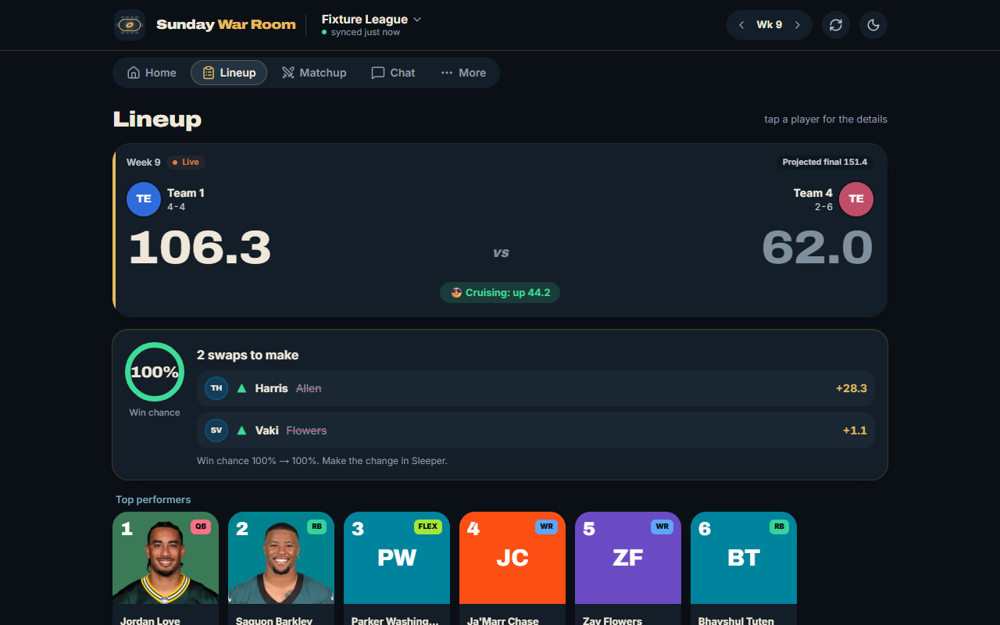
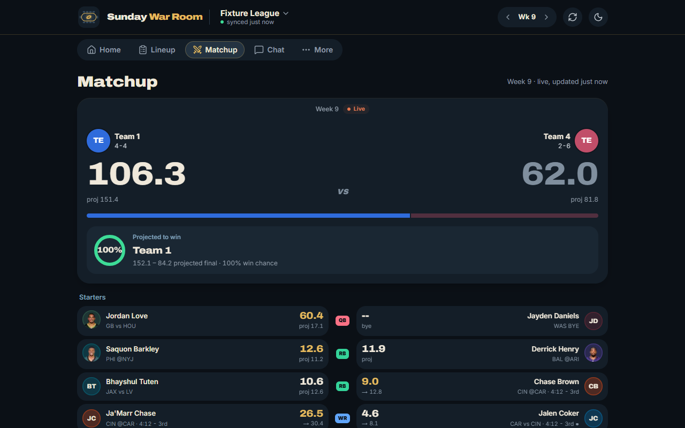
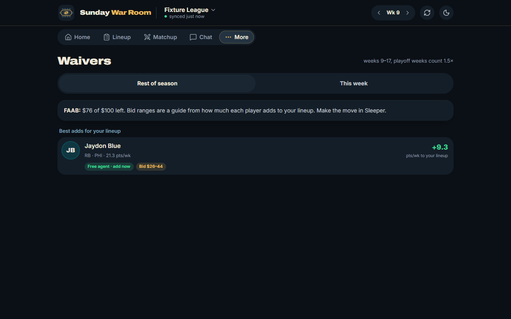
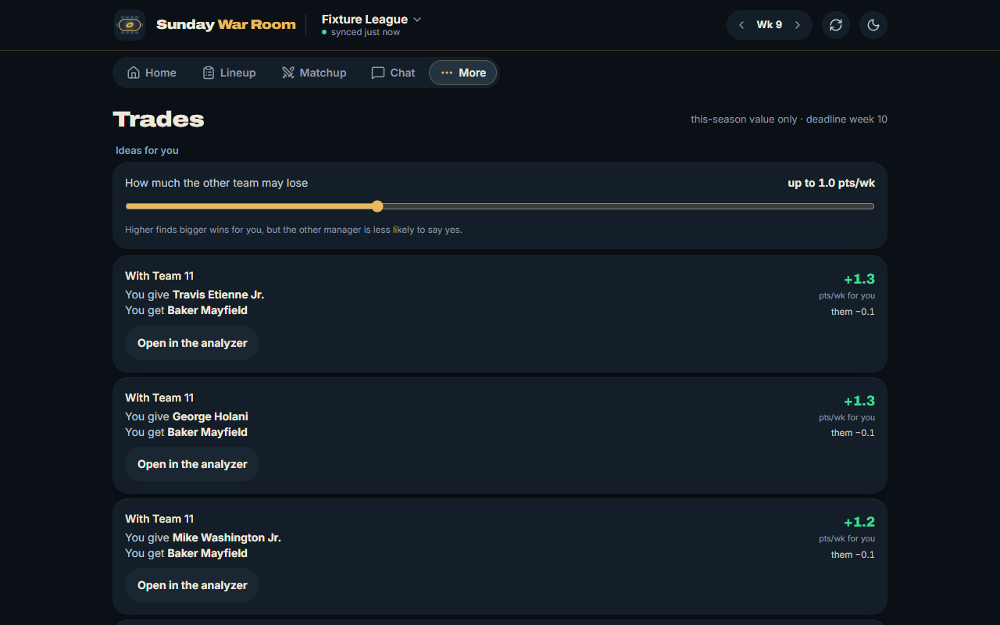

# Sunday War Room

A public, installable web app (PWA) that connects to your fantasy football
leagues and helps you make weekly decisions: start/sit, matchup outlook,
waivers, trades, a live game-day dashboard, and an AI assistant that answers
questions using your league's real data and Sunday War Room's own projection model.

> **Status:** Phases 1 and 2 are built, run locally with one command and pass CI on every push
> (260 backend tests at 99% coverage, 73 web and 81 end-to-end tests). P1: Sleeper sign-in,
> matchup, lineup optimizer, own projection model, accuracy tracking. P2: waivers ranked by
> value added to your lineup, a trade analyzer for any two teams, and live game day. The AI
> assistant is next; model upgrades and then deployment come last ([ADR-043](docs/Decisions/ADR-043-Phases-Renumbered.md)).
> All decisions and specs live in the [docs vault](docs/README.md).

| Lineup | Matchup (live) |
|---|---|
|  |  |
| **Waivers** | **Trades** |
|  |  |

*Screenshots from demo data (a recorded Sleeper league and an invented NFL week), not a real person's league.*

## Run it
Needs only [Docker](https://docs.docker.com/get-docker/). From this folder:
```bash
docker compose up --build
```
Open **http://localhost:3000**. With no email service configured, **"Email me a link" prints the
sign-in link in the web container's log** (`docker compose logs web`); then connect your Sleeper
username. The first start also loads NFL history in the background (about 10 seconds).
Settings and real credentials (Google, Resend): [.env.example](.env.example).

Developing the code natively instead: [api/README.md](api/README.md) and [web/README.md](web/README.md).

## Stack at a glance

| Layer | Choice |
|---|---|
| Frontend | Next.js + React + TypeScript, Tailwind CSS + shadcn/ui, PWA |
| Backend | Python FastAPI (API server + background worker) |
| API | REST + OpenAPI, generated TypeScript client |
| Data | PostgreSQL (+ pgvector), Redis job queue (ARQ) |
| Auth | Better Auth — Google sign-in + email magic links |
| AI | Claude tool-using agent + news retrieval (RAG) |
| Quality | pytest, Vitest, Playwright, GitHub Actions CI/CD |
| Ops | Docker + Compose, deployed to a container platform |

Every choice has a written decision record explaining the options and
trade-offs: see [docs/Decisions](docs/Decisions/INDEX.md).

## License

Copyright © 2026. **All rights reserved.** The source is public to read; it
may not be copied, modified or redistributed without permission. See
[ADR-028](docs/Decisions/ADR-028-Repo-Name-and-License.md).
